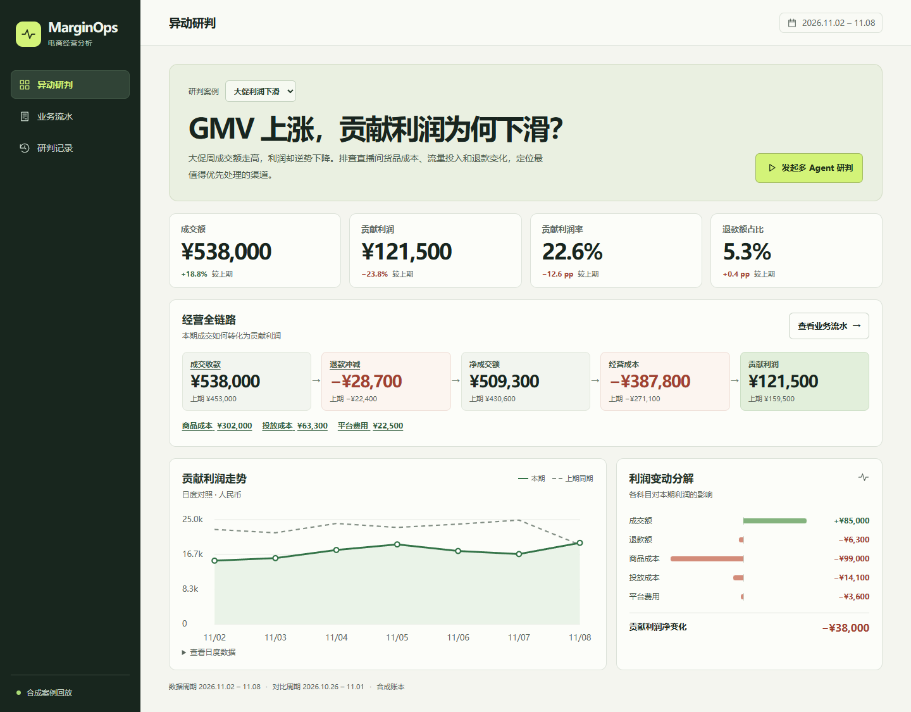
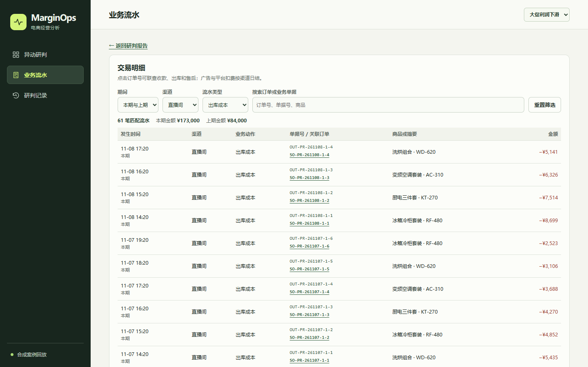
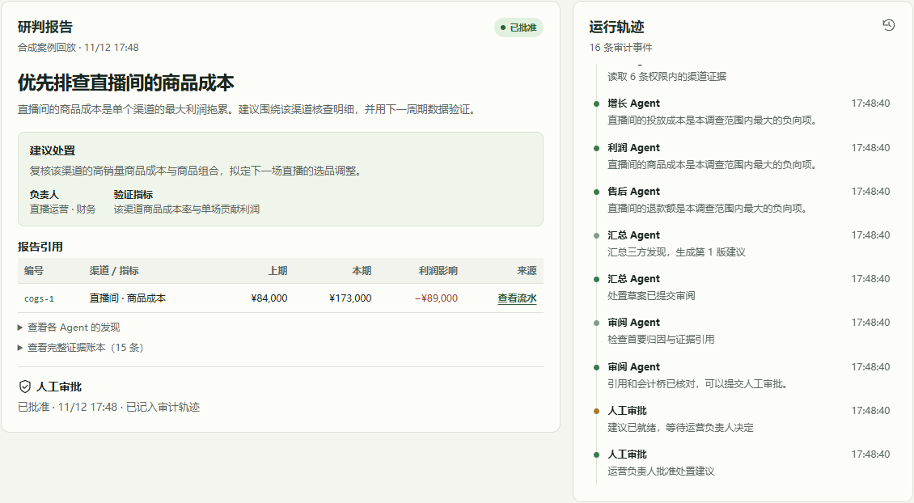
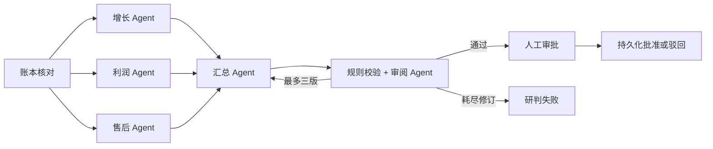

# MarginOps · 电商利润异动研判台

[](https://github.com/wangliwei-bb/marginops/actions/workflows/ci.yml)

大促周成交额上涨 18.8%，贡献利润却下降 23.8%。MarginOps 从渠道账本定位主要利润拖累，由三个专项 Agent 并行取证，生成带原始证据、负责人和验证指标的处置建议，再交给人审批。

项目附带三组可复现的合成案例，默认无需 API Key。配置实时模型后，同一个工作流会调用 OpenAI Responses API。



## 运行演示

需要 Node.js 24.12+（24.x）和 npm。

```bash
npm ci
npm run dev
```

打开终端给出的本地地址，选择 **大促利润下滑**。先在 **经营全链路** 查看成交收款、退款冲减、净成交额、经营成本和贡献利润。打开 **业务流水** 查看渠道对比和两期交易，按渠道、业务动作和单号筛选。点击订单号，可沿同一订单核对收款、出库和售后记录。

点击 **发起多 Agent 研判**。在报告的 `cogs-1` 引用处选择 **查看流水**，可直接核对直播间两期的出库成本，再返回报告审批。批准或驳回后，可在 **研判记录** 中重新打开报告。

- **商品分析**按渠道对比 SKU 的成交、退款、出库成本和商品利润。点击报告中的 **查看直播间的商品利润** 可带入渠道，再从 SKU 跳到对应的订单和售后流水。渠道日结广告费和平台费单独核算。
- **处置跟踪**收录已批准的建议，包括已有的审批记录。打开任务后填写执行计划并开始执行，复盘时填写验证结果并标记完成。每次状态变更和记录都保存在 SQLite 中，可回查原研判报告。

切换到 **投放成本攀升** 和 **退款率异常**，可以看到同一个工作流给出不同的归因与处置建议。



<details>
<summary>查看批准后的研判报告</summary>



</details>

构建并启动本地生产包：

```bash
npm run build
npm start
```

默认地址为 `http://127.0.0.1:4173`。审批与报告保存在 `.marginops/runs.sqlite`。

### 导入自己的 Excel 流水

在 **数据导入** 下载 [Excel 模板](public/marginops-import.xlsx)。用自己的流水替换示例行，保留表名和首行列名，填写两期开始日期和相同的天数后上传。模板中的示例可直接使用页面默认日期试跑。

| 工作表 | 列名 |
| --- | --- |
| 订单 | 订单行号、订单号、日期、渠道、SKU、商品名称、成交金额 |
| 退款 | 退款流水号、订单行号、日期、退款金额 |
| 成本 | 成本流水号、订单行号、日期、成本金额 |
| 渠道费用（可选） | 费用流水号、日期、渠道、费用类型、费用金额 |

- 每个订单商品行使用唯一的订单行号。退款和成本引用订单行号，退款表无数据时保留表头。跨期退款请带上关联的历史订单行。按收款、退款、成本各自的发生日入账，比较期间之外的流水不会纳入汇总。
- 金额统一用人民币元，支持两位小数。成交与退款填正数，零成本可填 0。渠道费用只接受广告费、平台费，未导入的渠道费用不计入利润。请将公式粘贴为值，长订单号和带前导零的编号请存为文本。
- 支持 `.xlsx`、5 MB、合计 20,000 行、30 个渠道。两期各 1–31 天且不得重叠。验证通过后作为独立案例保存在本地 SQLite 中，可从利润分析继续查看 SKU、流水和研判报告。
- 导入案例默认走本地规则研判。若启用实时模型，需在发起研判前勾选授权，才会把案例名称、渠道名称与汇总指标发送给 OpenAI。订单号、SKU、商品名和原始流水不进入模型请求。

### 启用实时模型

在项目根目录用 [.env.example](.env.example) 建立 `.env`。将 `MARGINOPS_MODE` 改为 `live`，填入 `OPENAI_API_KEY` 和账号有权限调用的 `OPENAI_MODEL`。模型需支持 Responses API 的函数调用和结构化输出。重启服务后，工作台会显示实时模型模式。

实时模型会收到案例信息与渠道汇总证据。Key 由服务端读取。`npm run eval -- --live` 会发起模型请求，常规测试使用回放。

## 工作流与工程取舍



- **证据边界**。订单收款、出库成本、退款、广告扣费和平台结算流水汇总为渠道科目及利润桥。每条渠道证据有稳定 ID，可追到源单据。三个专项 Agent 各自通过只读工具获取权限内证据。实时模式调用模型生成专项发现、汇总和审阅。
- **可解释的优先级**。本版把单个渠道最大的负向科目定义为优先排查项。代码核对首条引用、指标一致性和金额排名，审阅 Agent 检查文字是否夸大业务因果。处置动作和验证指标来自预设运营手册。
- **审批和恢复**。SQLite 以事务保存状态变更与审计事件。同一案例同时只接受一条进行中的研判，同一报告只接受一次人工决策。重启保留报告和决策，进行中的研判标记为失败并可重跑。
- **交互与可观测性**。React 接收 Server-Sent Events，在工作台显示取证、审阅与等待审批状态。可展开完整证据账本，复核每项金额和引用。

技术栈使用 Node.js 24、TypeScript 7、LangGraph.js 1.7、OpenAI SDK 7、Zod 4、React 19、Vite 8 和 SQLite。界面审阅参考了 [Vercel Web Design Guidelines skill](https://github.com/vercel-labs/agent-skills/tree/main/skills/web-design-guidelines)。

## 可复现验证

```bash
npm run check
```

检查包括生产构建、单元与集成测试和三个案例的端到端回放评估。GitHub Actions 在推送和拉取请求时运行同一命令。

| 合成案例 | 预期首要排查项 | 首条证据 |
| --- | --- | --- |
| 大促利润下滑 | 直播间商品成本 | `cogs-1` |
| 投放成本攀升 | 信息流投放成本 | `ads-1` |
| 退款率异常 | 平台旗舰店退款 | `refunds-1` |

`npm run eval` 核对归因、首条引用及三次取证调用，并输出每个案例的耗时和草案版本数。回放评估衡量工作流可复现性。接入模型后可单独运行评估，当前三个样本的结果只代表这三个合成场景。

## 运行边界

项目面向本地单进程作品演示。交易、订单、商品和渠道费用均为合成数据。趋势、指标、渠道对比和报告证据由同一批流水聚合。案例中的售后退款冲减收入，保留已确认的出库成本；广告和平台费用按渠道日结。审批代表记录人工决策，实际处置由负责人执行。系统只监听本地回环地址，操作员身份采用单用户假设。
